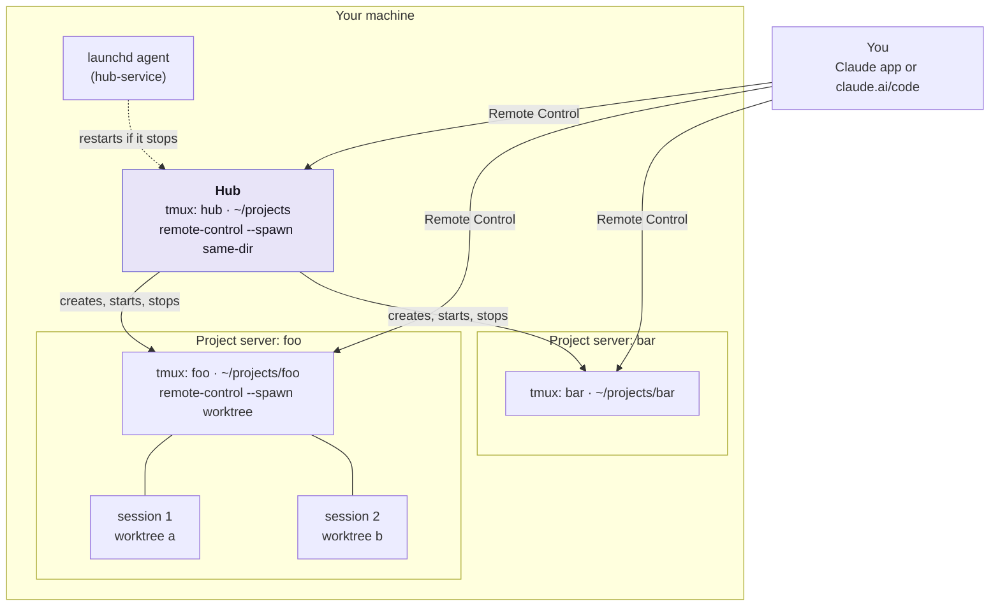

# new-project

A Claude Code plugin for running all your projects from your phone, on an always-on machine such as a Mac mini. It has two skills:

- **`new-project`**: ask for a new project and Claude creates the folder, writes your brief into it, makes a git repo, optionally creates a GitHub repo set up like one you already have, and starts a [Remote Control](https://code.claude.com/docs/en/remote-control) server for it in tmux, with each session in its own git worktree.
- **`hub-service`** (optional, macOS): installs a `claude-hub` command to start and stop the hub (below), and a launchd agent that keeps it running through crashes, network drops and reboots.

## The pattern

One Claude Code session, the **hub**, runs in your projects folder. You open it from the Claude app or claude.ai/code and ask it for new projects, or to start and stop project servers. Each project gets its own Remote Control server, and you work with each project's sessions directly. The hub sets projects up; it doesn't direct their work.



A new project shows up in your session list about a minute after you ask for it.

## Requirements

- [Claude Code](https://code.claude.com) signed in with a claude.ai plan that includes Remote Control (Pro, Max, Team or Enterprise; API keys don't work)
- `git` and `tmux`
- macOS for the `hub-service` skill (`new-project` works anywhere)
- [`gh`](https://cli.github.com), logged in with `gh auth login`, if you want GitHub repos
- For iOS projects: Xcode, and [XcodeGen](https://github.com/yonaskolb/XcodeGen) (`brew install xcodegen`)

## Install

In Claude Code:

```
/plugin marketplace add elliotwms/claude-new-project
/plugin install new-project@claude-new-project
```

Update later with `/plugin marketplace update claude-new-project`.

## Set up the hub

Start a session in your projects folder, then ask it to keep itself alive:

```bash
cd ~/projects && claude --rc "hub"
```

> Set up the hub service.

The `hub-service` skill installs a `claude-hub` command and a launchd agent (`local.claude-hub`) that runs `claude-hub ensure` every minute, starting the hub's tmux session if it isn't running and you haven't stopped it. Once it's installed you can close that first session: the agent starts the hub in tmux, and from then on you reach it from the Claude app.

For the hub to come back after a reboot, the machine needs automatic login (not available with FileVault on), because launchd agents start at login. The skill checks this and sleep settings, and tells you what to change.

The `hub-service` skill is macOS only. On Linux, the same start script works from a systemd user timer. Any other supervisor works too: `new-project` only needs `claude remote-control` running in your projects folder, in a tmux session named after `hub_session`.

### Why a server per project

In the Claude app, each machine running `claude remote-control` appears as a device card, and starting a session from it offers only the folders where a server is running. So the hub's folder is always there, and each project shows up once its own server is running, with `--spawn worktree` giving every session its own worktree.

### Want one always-on conversation instead?

If you'd rather keep a single long-running conversation alive, resumed after every restart, look at [waterbear](https://github.com/royashbrook/waterbear). It runs an interactive `claude --remote-control` session, so it doesn't give you the device card or new sessions from your phone, but it's well suited to an always-on assistant.

## Use

Open the hub and ask in plain words, for example:

> New project called `tide-times`: an iOS app showing tide times for the Welsh coast. Put it on GitHub.

Or run the skill directly with `/new-project:new-project tide-times`. If you leave out the name, the kind of project or whether you want GitHub, Claude asks once before starting.

By default the hub stops at the setup: it writes your description into the project's `CLAUDE.md` as a brief, commits it and starts the project's server, without writing any app code. Open the project from the device card and start designing it there. Set `"scaffold": "full"` to have the hub also scaffold and build the app, or ask for it in the request.

## Configure

Copy `config.example.json` to `~/.config/new-project/config.json` and edit it. Every key is optional; without the file the defaults apply.

| Key | Default | What it does |
|---|---|---|
| `projects_dir` | `~/projects` | Where new projects go |
| `github` | `ask` | `ask`, `always` or `never` create a GitHub repo |
| `github_owner` | your `gh` login | User or org that owns new repos |
| `visibility` | `private` | `private` or `public`; your request overrides it |
| `template_repo` | none | `owner/repo` template to create repos from (files only) |
| `settings_from` | none | `owner/repo` whose settings, rulesets and labels new repos copy |
| `managed_by` | none | `owner/repo` of the Terraform (or similar) repo that manages your GitHub repos |
| `spawn` | `worktree` | Remote Control spawn mode: `worktree` or `same-dir` |
| `permission_mode` | `acceptEdits` | Starting permission mode for remote sessions |
| `hub_session` | `hub` | tmux session name for the hub; no project can use it |
| `scaffold` | `brief` | `brief`: write the brief and stop; `full`: also scaffold and build the app |

### Keeping repos consistent

GitHub template repos copy files but not settings, rulesets or labels. To keep those consistent, set `settings_from` to a repo that's already set up the way you like. The skill copies its merge settings, features, repo-level rulesets and labels to each new repo. It leaves out anything that wouldn't work on the new repo and lists it in its report:

- organization rulesets, which already apply where they apply
- bypass permissions for specific teams, apps or users
- required status checks the new repo doesn't run, which would otherwise block every merge

Rulesets on private repos owned by a personal account need GitHub Pro. On the free plan those steps fail and the rest still apply.

If you manage GitHub repos with Terraform, set `managed_by` instead. The skill then opens a PR in that repo, following the pattern it already uses, and leaves applying it to you. It never runs `terraform apply`.

## Starting and stopping the hub

With `hub-service` installed:

```bash
claude-hub status        # is the hub running, and which project servers are
claude-hub stop          # stop the hub and keep it stopped, even after a reboot
claude-hub stop --all    # also stop every project server
claude-hub start         # start it again
```

You can also ask the hub to stop itself from your phone. It goes offline about ten seconds later, and can then only be started again from the Mac or over SSH with `claude-hub start`.

## Managing servers

The hub and each project's server run in tmux sessions: `hub`, and one named after each project.

- `tmux ls` lists them
- `tmux attach -t <name>` shows one (detach with Ctrl-b, then d)
- `tmux kill-session -t <name>` stops a project server (use `claude-hub stop` for the hub, or the agent restarts it within a minute)
- `tail ~/Library/Logs/claude-hub.log` shows when the hub was started and stopped

The agent only looks after the hub. Project servers stop if the machine restarts, and exit after about ten minutes without a network connection; ask the hub to restart them.

To remove the agent, ask the hub to remove the hub service, or:

```bash
launchctl bootout gui/$(id -u) ~/Library/LaunchAgents/local.claude-hub.plist
rm ~/Library/LaunchAgents/local.claude-hub.plist ~/.local/bin/claude-hub
rm -rf ~/.local/state/claude-hub
```

## Licence

[MIT](LICENSE)
